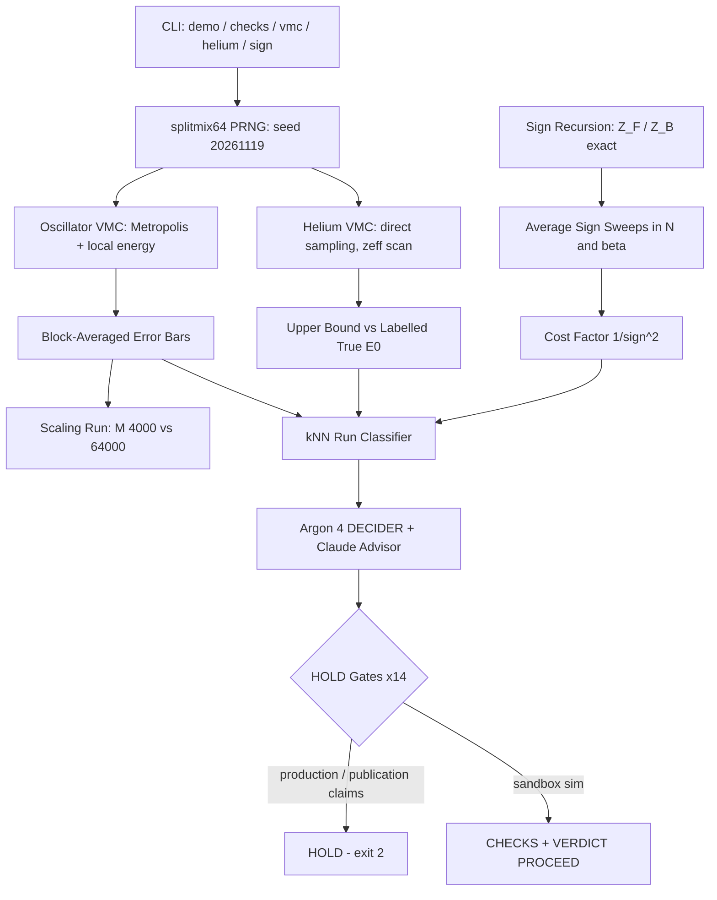
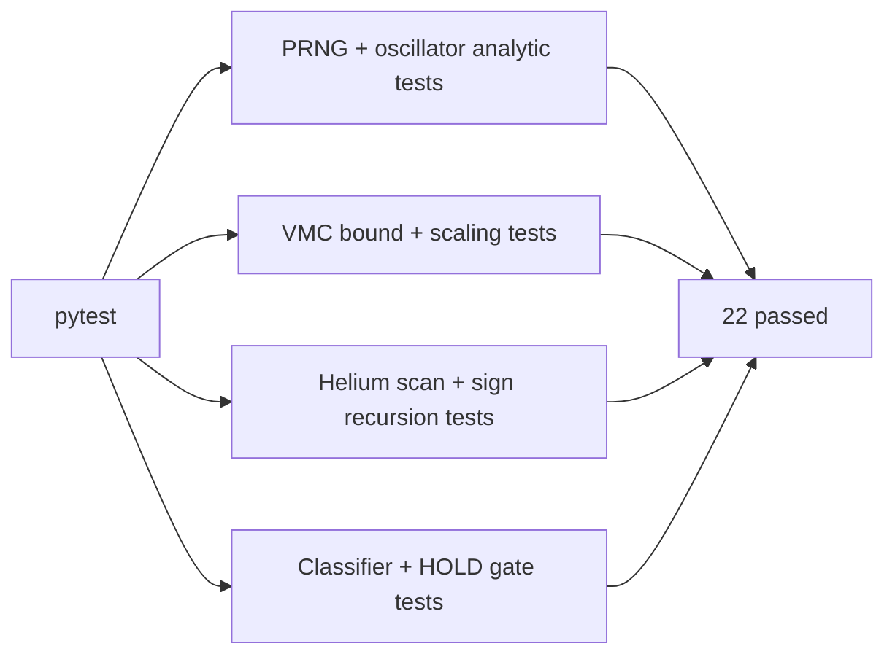
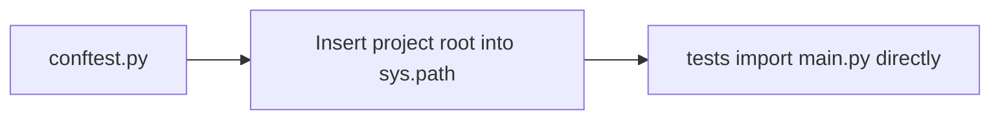
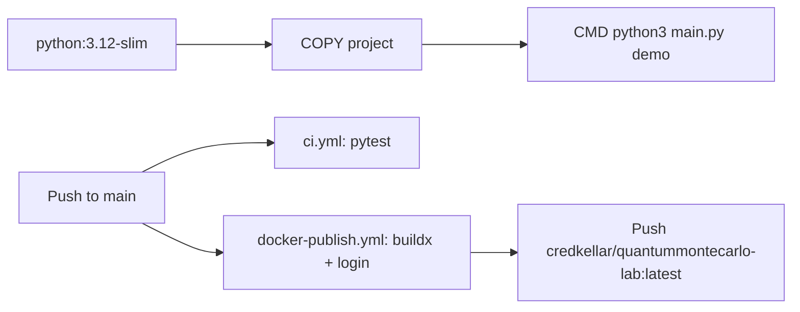

# QuantumMonteCarlo-Lab 🎲⚛️

**Quantum Monte Carlo Lab — Variational Monte Carlo, Error-Bar Scaling & The Sign Problem** — by Darion Kellar

QuantumMonteCarlo-Lab is an **educational quantum Monte Carlo lab** in ONE pure-Python file. It teaches the three ideas that decide whether a Monte Carlo number means anything, and it computes each one instead of asserting it:

- **The variational principle, measured** — variational Monte Carlo (VMC) for the 1D harmonic oscillator and a helium-like atom. A trial state's energy expectation is an **upper bound** on the true ground energy, so a wrong trial width must land *above* the exact answer — and the lab's wrong-width run does, beyond its own error bars (0.528950 ± 0.004449 vs the exact 0.5 at the optimum).
- **Error bars are computed, not decorated** — every estimate carries a block-averaged standard error, and the lab verifies the 1/√M law directly: 16× the samples shrink the bar by a measured factor **3.516**, against the predicted 4.
- **The sign problem, shown exactly** — for free fermions in a harmonic trap the average sign of the permutation weights is computed by an exact recursion (no sampling noise to hide behind): it collapses from 1.0 to **0.000553 at N = 6** (β = 0.5), and the sampling cost follows 1/⟨sign⟩² to **×3.27×10⁶**. A labelled toy demonstration — never a claim to have solved anything.

Everything is deterministic: one in-file **splitmix64** PRNG, seed **20261119**, drives every sampler, so the demo output is byte-identical between runs. Honest scope, stated up front: these are teaching systems (one oscillator, one screened two-electron atom, free fermions in a trap) with labelled reference values — no real molecule, material, or production calculation exists here, and every production use is a permanent HOLD gate (14 total). 🔒

[](https://github.com/kimanicollier44-cmyk/QuantumMonteCarlo-Lab/actions/workflows/ci.yml)
[](https://github.com/kimanicollier44-cmyk/QuantumMonteCarlo-Lab/actions/workflows/docker-publish.yml)

> ℹ️ These are the **live** workflow badges for this repo. They activate as soon as the `ci.yml` and `docker-publish.yml` files from the paste pack are pasted into `.github/workflows/` — until then they have nothing to report yet.

## 🧰 Tech Stack Badges & Full Architecture Tech Stack

### 💻 Core Programming Languages & Core Systems


- 🐍 Python 3.12, pure standard library (`math`, `hashlib`, `json`, `sys`) — zero dependencies, zero network, deterministic (double-run byte-identical)
- 🎲 PRNG from scratch: **splitmix64** (one 64-bit state, fixed increment, bijective mix), seeded once from the named seed `20261119` — every sampler draws from it, so the whole lab is reproducible bit for bit
- 🌊 VMC core: Metropolis sampling of |ψ|² for the oscillator (local energy analytic, burn-in discarded, acceptance tracked over *all* proposals) and direct independent sampling for the helium-like atom, whose |ψ|² factorises — radius ~ Gamma(3, 2·zeff) built from three exponentials, direction uniform on the sphere
- 📏 Error-bar core: block averaging — means inside blocks of 100 (oscillator) or 200 (helium) samples, standard error of the block means — because consecutive Markov-chain samples are correlated and the naive bar would lie
- ➖ Sign core: the canonical partition-function recursion `Z_N = (1/N) Σ_k (±1)^(k+1) z1(kβ) Z_{N−k}` with `z1(β) = 1/(2 sinh(β/2))` — exact arithmetic, refereed against the ground-state-dominance asymptote `exp(−βN(N−1)/2)` to under 1e-6 relative
- 🧠 TinyML kNN run classifier (from scratch, stdlib, distance-weighted): converged / under-sampled / sign-blocked from (variational excess, block stderr, average sign), labels from the lab's own policy
- 🪑 Council seats: Gemini Argon 4 DECIDER (names-only, tighten-only) + Muse advisor (never overrides HOLD) + Google Flow plan-only (rendered = False, live = 0)

### ⛓️ Web3 & Infrastructure

- 🚫 **Not applicable — honestly.** No blockchain, no Web3, no tokens: the "infrastructure" in this lab is one offline file holding a PRNG, two VMC samplers, and an exact recursion. Production chemistry and materials claims are permanent HOLD gates, not features. No fake badges here.

### ⚙️ Platform Support & Hardware Architecture


- 🖥️ Pure Python — runs anywhere Python 3.12+ runs (Linux, macOS, Windows), plus the `python:3.12-slim` Docker image
- 🔒 No hardware is controlled, ever: real spectrometers, clusters, and quantum hardware are outside this lab; hardware benchmark claims are a permanent HOLD gate (see the gate table below)

### ⚡ Low-Level Infrastructure & Performance

- 🚫 **No low-level code — honestly.** No C, no C++, no GPU, no compiled extensions: this is one interpreted Python file on purpose, so every sample can be read, checked, and diffed. Performance here means honest statistics — block-averaged error bars that account for autocorrelation, and a sign recursion whose cost is O(N²) exact arithmetic instead of an exponentially dying sampling run.

### 🛠️ DevOps & Build Tools


- 🐳 Docker (`python:3.12-slim`), GitHub Actions CI + Docker Publish (delivered in the paste pack)
- 🎯 Target image: `credkellar/quantummontecarlo-lab:latest`
- 🧪 Tests: `pytest` (22 tests) + the built-in CHECKS suite (44 checks) in `main.py`

### ☁️ Cloud Providers

- 🚫 **None — honestly.** No cloud provider is used or needed: the lab runs fully offline on your own machine or in a local Docker container. Docker Hub appears only as the registry the publish workflow pushes the image to.

## What this does?

1. 🎲 **A seeded PRNG before anything else** — splitmix64 with the named seed **20261119**: every sampler in the lab draws from it, the stream is asserted reproducible bit for bit, and its uniform mean over 2,000 draws is checked against 0.5. Monte Carlo without a seed is an anecdote; this lab's numbers can be re-derived by anyone.
2. 🌊 **VMC on the harmonic oscillator** — Metropolis sampling of a Gaussian trial state ψ(x) = exp(−αx²) with the analytic local energy E_L(x) = α + (½ − 2α²)x². At the optimal α = 0.5 the estimate is **0.500000 with a zero error bar** — the local energy is the constant 0.5 for every sample, the zero-variance signature of an exact eigenstate, reproduced by the sampler.
3. 📈 **The variational principle, measured** — at the wrong width α = 0.35 the estimate is **0.528950 ± 0.004449**, strictly above E0 = 0.5 beyond the error bars, and consistent with the exact family curve E(α) = α/2 + 1/(8α) = 0.532143. A wrong trial state can only cost energy — here that is a measurement, not a slogan.
4. 🧾 **Equilibration + acceptance bookkeeping** — every Metropolis run discards a stated burn-in (2,000 proposals) before keeping samples, and the acceptance rate is counted over *all* proposals, burn-in included: **0.636** at the optimum, **0.690** at the wrong width — both asserted inside the sane window (0.2, 0.8), because a chain that accepts everything or nothing is not sampling.
5. 📏 **The 1/√M law, verified** — at α = 0.35, M = 4,000 samples give stderr **0.008767** and M = 64,000 give **0.002493**: a measured shrink ratio of **3.516** against the √(16) = 4 prediction (asserted in the window 3.0–5.5; autocorrelation keeps the measured ratio honestly below the ideal). Sixteen times the samples buys four times the precision — no more.
6. ⚛️ **VMC on a helium-like atom** — two electrons, trial state exp(−zeff(r1+r2)) with **no Jastrow factor** (stated openly: correlation enters only through the mean repulsion). The scan over zeff ∈ {1.4, 1.55, 1.6875, 1.85, 2.0} bottoms out at the analytic optimum 27/16, and the long run gives **−2.84851 ± 0.00495 Ha** against the family minimum −2.84766.
7. 🛡️ **An upper bound doing its job** — the helium estimate stays **above the labelled true E0 = −2.903724377 Ha beyond its error bars**: the variational bound holds under sampling noise. The ~0.055 Ha gap to the true value is the printed price of the Jastrow-free trial state — and a built-in referee agrees: ⟨1/r12⟩ comes out **1.0556** vs the exact 5·zeff/8 = 1.0547.
8. ➖ **The sign problem, exactly** — the permutation-sign recursion for free fermions in a harmonic trap gives ⟨sign⟩ = Z_F/Z_B with no statistical error at all: at β = 0.5 it falls **1.0 → 0.606531 → 0.223130 → 0.049787 → 0.006738 → 0.000553** for N = 1…6, strictly monotone, and at N = 3 it falls 0.472367 → 0.002479 as β goes 0.25 → 2.0.
9. 💸 **The cost wall, priced** — reweighting from the bosonic weights costs 1/⟨sign⟩²: **×20** at N = 3, **×3.27×10⁶** at N = 6, **×1.45×10¹²** at N = 8 (β = 0.5) — for *free* particles in a *toy* trap. The recursion is refereed against the ground-state asymptote exp(−βN(N−1)/2) to under 1e-6 relative, so the collapse is arithmetic, not noise. Labelled a demonstration, never a solution.
10. 🏷️ **Run classifier + seats + checks** — a from-scratch distance-weighted kNN labels finished runs converged / under-sampled / sign-blocked from their own measured (excess, stderr, ⟨sign⟩): the optimal oscillator run → converged, a deliberately short 1,200-sample run → under-sampled, the helium long run → converged, the N = 6 sign toy → sign-blocked — with Argon 4 DECIDER (sha256 trace), Muse advisor, Google Flow plan-only, 14 permanent HOLD gates, and a built-in CHECKS suite (44 checks) that re-derives every headline number above.

## 🗺️ How it works — diagram per script

### `main.py` — the whole lab



### `tests/test_main.py` — verification



### `conftest.py` — test path setup



### `Dockerfile` + CI flow — container & publish



## Why is this cool?

1. 🎯 The optimal-width run is **exact, not lucky**: the local energy is the same number (0.5) at every sampled point, so the Monte Carlo returns E0 with a zero error bar — the zero-variance principle, visible in raw output.
2. 📈 The variational principle stops being a textbook sentence: the wrong-width run lands at 0.528950 ± 0.004449, provably above 0.5 *by its own error bar*, and on top of the analytic curve it belongs to.
3. 📏 The error-bar law is **measured on the lab's own runs**: 3.516× shrink for 16× samples, close to — and honestly below — the ideal 4×, because autocorrelation is real and the lab says so.
4. ⚛️ The helium scan finds the screened charge 27/16 **by sampling**, then the long run's bound (−2.84851 ± 0.00495) is checked against a labelled true value it is never allowed to cross.
5. 🔍 A built-in referee watches the sampler: ⟨1/r12⟩ must match 5·zeff/8, so a subtly wrong sampler would get caught by physics, not by eyeballing.
6. ➖ The sign problem is shown with **exact arithmetic**: no error bars to blame, just a recursion printing 1.0 → 0.000553 → gone, with the ×3.27×10⁶ cost invoice attached.
7. ❄️ Cooling is quantified as a cost, not a mood: at N = 3, going from β = 0.25 to β = 2.0 cuts the average sign by a factor of ~190.
8. 🎲 One named seed (20261119) makes the entire lab — samplers, scans, sweeps — reproducible bit for bit; run it twice, get the same bytes.
9. 🧾 The bookkeeping is part of the output: burn-in counts, acceptance rates over all proposals, block counts — the things real QMC papers report, printed by default.
10. 🏷️ The classifier closes the loop: runs are labelled by their own measured excess, error bar, and average sign — a run that is under-sampled or sign-blocked gets called exactly that.

## What problems this solves?

1. ❌ **Problem:** "Monte Carlo said so" numbers circulate with no error bar at all. ✅ **Solution:** Every estimate in this lab is inseparable from its block-averaged standard error, and CHECKS fail if a headline estimate and its bar disagree with the analytic referee.
2. ❌ **Problem:** The variational principle is quoted but rarely *seen*. ✅ **Solution:** The wrong-width oscillator run is above E0 beyond its error bars, and the helium estimate stays above the labelled true E0 — the bound is demonstrated twice, in two different systems.
3. ❌ **Problem:** Naive error bars ignore autocorrelation and shrink too fast on paper. ✅ **Solution:** Block averaging over 100–200-sample blocks, and the scaling check asserts the measured shrink ratio (3.516) sits in an honest window around √16 — not equal to it by construction.
4. ❌ **Problem:** Trial-state optimisation is often a black box. ✅ **Solution:** The helium zeff scan prints MC and exact energies side by side at five points; the sampled minimum lands on the analytic optimum 27/16, and the improvement over the unscreened zeff = 2 is significant beyond the bars.
5. ❌ **Problem:** Samplers can be quietly wrong (bad geometry, bad weights) and still print plausible energies. ✅ **Solution:** Independent referees — the analytic family curves, the ⟨1/r12⟩ identity, the sign asymptote — grade the sampling machinery itself.
6. ❌ **Problem:** The sign problem is usually described in words ("it's exponential") without a number attached. ✅ **Solution:** An exact recursion prints ⟨sign⟩ and the 1/⟨sign⟩² cost factor per (N, β): ×20 at N = 3 becomes ×1.45×10¹² at N = 8, for free particles.
7. ❌ **Problem:** "We solved the sign problem" claims keep appearing. ✅ **Solution:** The lab labels its demonstration a toy in the docstring, the demo, the README, and the checks — and `sign_problem_solved_claim` is a permanent HOLD gate.
8. ❌ **Problem:** Burn-in and acceptance are hidden, so a stuck chain looks like a result. ✅ **Solution:** Burn-in is discarded and counted, acceptance is reported over all proposals and asserted inside (0.2, 0.8) — a chain outside that window fails the checks.
9. ❌ **Problem:** Teaching QMC usually needs NumPy/SciPy stacks that obscure the statistics. ✅ **Solution:** One stdlib file — PRNG, Metropolis, direct sampling, blocking, recursion — every step readable and diffable.
10. ❌ **Problem:** Simulation output quietly graduates into production claims. ✅ **Solution:** 14 named HOLD gates return exit code 2 for every production-chemistry, materials, drug, energy, benchmark, or publication claim, forever.

## How to install this?

1. 📋 Clone or download this project folder.
2. 🐍 Make sure Python 3.12+ is installed: `python3 --version`
3. ▶️ Run the full demo + checks (no arguments needed):

```bash
python3 main.py
```

4. 🧪 Run the test suite:

```bash
pip install pytest
python3 -m pytest -q
```

5. 🎛️ Try the other commands:

```bash
python3 main.py checks      # 44 built-in checks
python3 main.py vmc         # oscillator VMC report (JSON)
python3 main.py scaling     # error-bar 1/sqrt(M) scaling report (JSON)
python3 main.py helium      # helium scan + optimal run report (JSON)
python3 main.py sign        # sign-problem sweeps report (JSON)
python3 main.py classify    # kNN run classifier report
python3 main.py brains      # Argon 4 + Muse + Flow seats
python3 main.py holds       # list all 14 HOLD gates
python3 main.py hold-demo   # exits 2 - gated actions stay HOLD
```

6. 🐳 Or run it in Docker:

```bash
docker build -t credkellar/quantummontecarlo-lab:latest .
docker run --rm credkellar/quantummontecarlo-lab:latest
```

## Requirements

- 🐍 Python 3.12 or newer
- 📦 Dependencies: **none** (standard library only)
- 🌐 Network: **none** — fully offline
- 🧪 For tests only: `pytest`
- 🐳 Optional: Docker

## FULL project structure tree

```text
quantummontecarlo-lab/
├── main.py                  # the whole lab: splitmix64 PRNG, oscillator VMC, error scaling, helium VMC, sign recursion, classifier, seats, HOLD gates
├── conftest.py              # puts the project root on sys.path for tests
├── tests/
│   └── test_main.py         # 22 pytest tests: PRNG, VMC bounds, scaling, helium, sign, gates, determinism
├── assets/
│   └── cover.png            # README cover image (2736 x 912)
├── Dockerfile               # python:3.12-slim, runs the demo
├── .gitignore               # __pycache__/, .pytest_cache/, *.pyc
└── README.md                # this file
```

> 📦 Delivered separately as paste packs (not in this tree): `.github/workflows/ci.yml` + `docker-publish.yml`, and the Docker Hub pack (100-char description, 350-char About, overview, categories).

## 🔒 HOLD gates — all 14, permanent

| # | Gate | What stays held |
|---|------|-----------------|
| 1 | `production_chemistry_claim` | No production quantum chemistry; a teaching VMC run is not a chemistry result |
| 2 | `real_molecule_accuracy_claim` | No claim of chemical accuracy for any real molecule or material |
| 3 | `drug_design_claim` | No drug-design, binding-affinity, or pharmaceutical use |
| 4 | `materials_certification_claim` | No certifying a real material's properties from a lab estimate |
| 5 | `catalyst_design_claim` | No catalyst design or reaction-rate claims |
| 6 | `battery_material_design_claim` | No battery or energy-storage material design claims |
| 7 | `superconductor_material_claim` | No superconductor discovery or Tc claims |
| 8 | `nuclear_simulation_use` | No nuclear, weapons, or defence simulation use |
| 9 | `sign_problem_solved_claim` | The sign problem is demonstrated here, never solved; no claim otherwise |
| 10 | `production_software_claim` | This is a teaching lab, not production QMC software |
| 11 | `hardware_benchmark_claim` | No hardware benchmark or procurement claims from lab timings |
| 12 | `investment_claim` | No investment claims; a lab model is not a prospectus |
| 13 | `patent_claim` | No patent, novelty, or priority claims from lab output |
| 14 | `publication_result_claim` | Lab numbers are teaching values, not publishable research results |

🧑‍⚖️ **Council seats:** Gemini Argon 4 Extended Thinking — DECIDER (names-only, tighten-only, MAP → MODEL → STRESS → DECIDE, sha256 trace, `can_override_hold = False`) · Muse — advisor (`can_override_hold = False`) · Google Flow — plan-only (`rendered = False`, `live = 0`).

✅ **Verification:** pytest **22 passed** (project + clean copy) · built-in CHECKS **44/44** · double-run output **byte-identical** · `hold-demo` exits **2** · `main.py` **768 lines**, pure stdlib, zero network.

## 🧒 5th-grade English section

Imagine you want to find the lowest valley in a foggy mountain range, but you can only take a few steps at a time and measure how high you are standing. 🏔️

- This lab rolls dice — but **honest dice**: a tiny built-in dice machine with a named seed (20261119), so if you roll them again tomorrow you get the exact same numbers. 🎲
- For a tiny pretend atom, the lab guesses a shape for its electron cloud and throws thousands of darts at it. The average height of the darts gives the energy — and a special rule of nature says this average can **never be lower than the true lowest energy**. A bad guess always scores worse, and the lab proves it with numbers. 🎯
- Every answer comes with a **plus-or-minus** — how shaky the answer is. Throw 16 times more darts and the shakiness shrinks by about 4 times. Not 16 times better — only 4. The lab measures that too, because wishing doesn't change math. 📏
- Then comes the spooky part. Some particles (called fermions) make half the darts count as **minus points**. With a few particles it's fine; with eight, the plus and minus darts almost perfectly cancel, and you'd need a trillion times more darts to see anything. Scientists call that the **sign problem**, and this lab shows it happening with exact math — it does not fix it, and it says so. ➖
- This project is a **pretend lab on a computer**. It does not design real medicines or real materials. It teaches how scientists estimate energies with dice — and exactly where the dice stop working. 💻

---

MIT © 2026 Darion Kellar · QuantumMonteCarlo-Lab — educational simulation only 🎲
